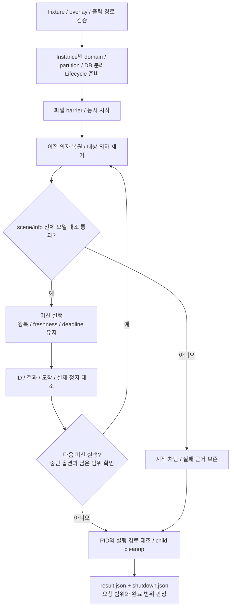

# Gazebo 시나리오 반복 검증

## 범위와 입력

Fortress, Nav2/AMCL, reactive safety, obstacle memory, 센서, wheel odometry를 연결해 시설 월드의 왕복 주행을 검증합니다. 책상 작업은 mock이며 실물, manipulation 완료는 별도 검증이 필요합니다.

대상 의자만 제거하고 다른 의자는 유지합니다. 이전 43/13 fixture에서는 누락 의자 두 개를 먼저 복원합니다. 모델 대응은 `office_chair_NN` / `facility_chair_ROOMN`입니다.

| 항목 | 기준 |
|---|---|
| 도착 | 8 cm |
| Navigation deadline | 180초 |
| 실행 중 gate | Freshness, 속도, 취소 기준 유지 |
| Instance 분리 | ROS domain=`domain-base+i`, 고유 partition, DB, 출력 |
| 시작 | 준비 완료 후 파일 barrier로 동시 시작; lifecycle manager 세 개 순차 STARTUP |

## 1. 실행 준비



Humble에서 `make build-scenario-runtime`을 실행한 뒤 아래 명령을 호스트에서 호출합니다. Container에서도 동일한 소스, 데이터 절대 경로에 접근할 수 있어야 합니다.

```bash
python3 tests/scenario_validation/parallel.py \
  --root "$PWD" --container ros2-humble \
  --count 1 --name smoke-001 --seat seat-44 --sequence seat-44,seat-16 \
  --stop-on-failure --domain-base 120
```

| 경로 | 기본값 / 변경 옵션 |
|---|---|
| Data root | ../cleany-data / --data-root, CLEANY_DATA_ROOT |
| Fixture | fixtures/cad-fortress-command-hold / --fixture |
| 출력 | runs/scenarios/name / --output-root |
| Runtime overlay | builds/worktree/install-scenario-runtime/setup.bash / --runtime-overlay |
| Build root | CLEANY_BUILD_ROOT |
| AMCL | system / --amcl-overlay |
| Navigation | baseline / --navigation-overlay |
| 관측 overlay | --diagnostic-overlay |

기존 출력은 덮어쓰지 않으며 fixture/overlay가 누락되면 실행 전에 실패합니다. Container는 호출자의 UID/GID를 사용하므로 해당 UID가 container 안에서도 유효해야 합니다.

| 실행 선택 | 옵션과 명령 |
|---|---|
| 좌석 | `--seats` |
| 연속 왕복 | `--repeats` |
| 재시작 없는 전환 | `--sequence` |
| Queue | `queue.py --root "$PWD" --jobs JOBS.json`; parallel 옵션의 JSON 객체 배열, boolean 지원 |

Commit, branch, dirty, install prefix, 소스/입력/바이너리 hash를 기록합니다. Git identity는 호스트의 `source.json`으로 고정한 뒤 worker에 전달합니다.

## 2. Fixture와 profile 고정

URI의 `repo://`는 checkout, `fixture://`는 선택한 fixture를 가리킵니다. 상대 file과 로컬 Fuel cache도 지원합니다. 과거 절대 경로를 추측해 치환하지 않으며, 활성 URI 이관 manifest와 과거 hash는 별도로 보존합니다.

후보 profile `profiles/cad_fortress_command_hold.yaml`은 CAD Fortress yaw 보정, DWB 비용, 발행 명령의 0.2초 hold 충돌 검사를 설정합니다. 실물 보정값으로 사용하지 않습니다.

```bash
python3 tests/scenario_validation/prepare_profile.py \
  /path/to/cleany-data/fixtures/baseline /path/to/cleany-data/fixtures/candidate \
  --profile tests/scenario_validation/profiles/cad_fortress_command_hold.yaml
```

생성 결과는 `--fixture`, yaw 보정을 지원하는 odometry, 현재 navigation overlay와 함께 실행합니다. 기존 결과는 덮어쓰지 않습니다. 설정 두 개를 새로 생성하고 나머지는 원본 symlink로 연결합니다.

실행 중 원본 fixture는 고정하며 profile/config, mesh/material/texture SHA-256을 기록합니다. Fuel도 로컬 cache 파일을 고정합니다. 누락, 빈 asset, 미지원 URI, geometry 로딩 오류가 있으면 미션을 시작하지 않습니다. Profile 생성, 단위 테스트 통과와 50/60 달성은 별도의 판정입니다.

## 3. 의자 전환

의자는 static group 밖에 유지하며 Gazebo create/remove로 이전 의자를 복원하고 다음 대상을 제거합니다. 매 미션 전에 `scene/info`에서 전체 의자와 전체 모델을 대조합니다. 이전 의자가 존재하고 대상 의자만 없는지 실제 장면으로 확인합니다.

| 조건 | 처리와 근거 |
|---|---|
| Service ACK 수신 | 실제 장면 확인 후 전환 인정 |
| 응답 유실 | 실제 장면을 조회하고 이미 적용된 작업은 반복하지 않음 |
| 미적용 작업, 장면 조회 | 최대 3회; transport 3초 / CLI 6초 |
| 장면 조회 실패, 다른 모델 변경 | 미션 시작 금지 |
| 원본 응답, hash | `chair-scenes/` |
| 시도 이력 | `chair-transitions/` |

전환은 fixture 작업이며 navigation deadline, 충돌, 도착, freshness gate는 유지합니다. 동적 의자 profile의 자원량과 immutable scene benchmark는 구분합니다.

## 시나리오 종류

| 이름 | 입력 / 확인 |
|---|---|
| normal | 정상 왕복 |
| cancel_outbound / cancel_return | 출발, 복귀 취소 |
| safety_stop | synthetic E_STOP 전달, 정지; 물리 producer 검증 아님 |
| sensor_loss | depth adapter 종료; 취소 전 실제 정지 확인 |
| obstacle / blocked | 장애물 / target 주변 폐쇄 |
| path_failure | 실제 planner process 유실 |

실패, 정지는 원래 navigation 제한 안에서 판정합니다. 정상 성공과 기대한 실패 시나리오 통과는 따로 집계합니다.

## 4. 결과와 종료 판정

원본은 `batch.json`, `resources.json`, world manifest, `trace.jsonl`, `result.json`, `shutdown.json`, ROS/Gazebo 로그입니다. 최초 실패, 자원 포화, 준비 실패도 보존합니다. 미션별 `progress.json`은 atomic하게 기록하며, 최종 근거는 `result.json`과 `shutdown.json`입니다.

| 선택, 도구 | 판정 |
|---|---|
| `--stop-on-failure` | 첫 정상 실패에서 중단; 요청 범위와 `stopped_on_failure` 기록 |
| `--failure-limit 11` | 60회 중 50회 성공이 불가능하면 중단; 첫 실패 옵션 우선 |
| `continuous_verdict.py WORKER --output FILE` | 6좌석×10 순서, 의자, ID, 왕복 결과, 정지, 종료 대조 |
| `inventory.py FIXTURE` | 전체 좌석 의자 조건 확인 |
| `audit.py OUTPUT` | Mission ID, 예상 결과, cmd_vel/GT 정지, shutdown 확인 |

부분 50건 실행, 오래된 다른 mission 결과, 명령만 0이고 실제로는 이동하는 상태는 통과할 수 없습니다. Harness 관찰 시간은 요청 수에 비례하지만 개별 navigation deadline은 유지합니다. 종료 시에는 PID와 현재 실행 경로를 다시 대조한 뒤 cleanup합니다.

Navigation overlay를 재검증할 때는 `--navigation-overlay "$(make -s print-navigation-install-base)/setup.bash"`를 사용합니다. 실제 prefix, plugin/wheel odometry source hash를 기록하고 원래 실패와 수정 후 결과를 분리합니다.

## 보조 도구와 과거 근거

| 작업 | 명령과 위치 |
|---|---|
| 보조 코드 단위 검사 | `make test-scenario-tools`; 실제 Gazebo 검증은 별도 |
| 대표 좌석 선택 | `representatives.py RUNS --fixture FIXTURE --jobs JOBS.json` |
| 보정 시도 | `--corrections`; 원래 시도도 보존 |
| 과거 driver/job/profile | `CLEANY_DATA_ROOT/experiments/legacy-20261010`; 그대로 재실행 금지 |

GPU는 NVIDIA EGL 파일이 존재할 때만 선택하고 Mesa 설정은 유지합니다. GPU 도구가 없으면 미측정으로 기록합니다. 호스트별 처리량, RTF와 fresh, continuous 결과를 구분합니다. 원본 위치는 [EVIDENCE](../../docs/EVIDENCE.md)에서 확인합니다.
