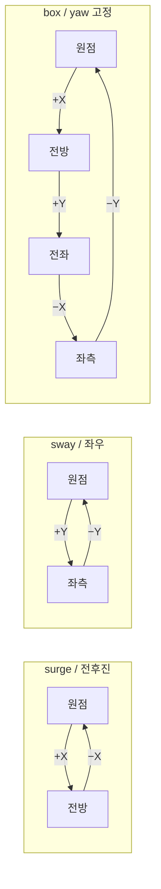
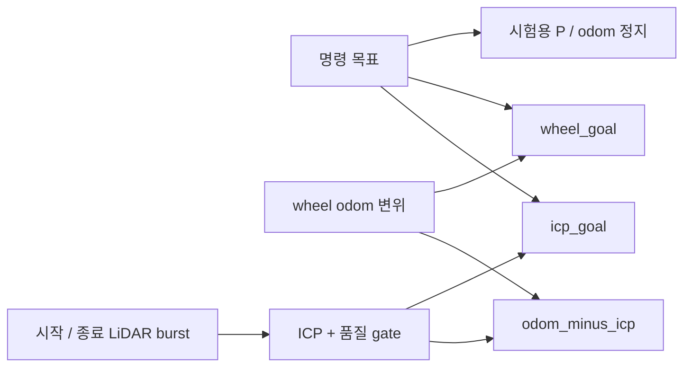

# 실물 베이스의 정지 응답과 odometry 평가

휠 피드백으로 정지한 위치와 LiDAR 또는 바닥 마킹으로 측정한 변위를 비교합니다. 평가용 P 제어는 상시 주행 controller나 wheel geometry 보정과 별개입니다.

| 확인하려는 것 | 진입점 | 입력 |
|---|---|---|
| 한 패턴의 왕복 잔차 | `run_eval.sh` | pattern / 거리 / 회전 수 |
| 속도별 wheel odom 재측정 | `run_wheel_only_eval.sh` | [wheel 평가 config](../../configs/mission/wheel_odometry_evaluation.json) |
| 축별 P 응답과 외부 오차 | `run_motion_response.sh` | [전 축 프로토콜](validation-protocol.md) |
| 저장 스캔만 다시 정합 | `replay_scan_matches.py` | response summary + NPZ; ROS/장치 사용 안 함 |

## 1. 사전 준비 및 바닥 마킹

1. 최소 3.5×3.5 m의 평탄하고 장애물 없는 바닥을 확보합니다. 기본 legacy 패턴의 시작점 기준 최대 변위는 3.0 m입니다.
2. 바닥 십자선과 로봇 외곽 기준점을 정렬합니다. 필요하면 전방 2.5 m, 좌측 2.0 m에도 마킹합니다.
3. 물리 Emergency Stop을 즉시 사용할 수 있게 준비하고 다른 명령원을 종료합니다.
4. Dry-run으로 해당 **실행 경로의** 거리·속도·반복 수를 확인합니다. 전 축 응답 시험은 별도 0.5 m/90° 한계입니다.

## 2. 노드 기동

| 실행 경로 | 노드 준비 |
|---|---|
| `run_eval.sh` | 아래 Agent와 base driver, 선택 LiDAR를 미리 실행 |
| `run_wheel_only_eval.sh`, `run_motion_response.sh` | runtime config로 준비/재사용; [자동 기동 조건](#자동-기동과-준비-확인) |

```bash
# 터미널 1: exact by-id 장치를 CLEANY_ESP_PORT에 지정한 뒤 실행
source /opt/ros/humble/setup.bash
source esp32/micro_ros/agent/install/local_setup.bash
export ROS_DOMAIN_ID=0
ros2 run micro_ros_agent micro_ros_agent serial --dev "$CLEANY_ESP_PORT" -b 115200
```

```bash
# 터미널 2
source /opt/ros/humble/setup.bash
source "$(make -s print-install-base)/setup.bash"
export ROS_DOMAIN_ID=0
ros2 launch cleany_base_driver base_driver.launch.py   mock:=false config:="$PWD/ros2_ws/src/cleany_base_driver/config/base_hardware.yaml"
```

## 3. 평가 스크립트 실행

Ubuntu 22.04 외 호스트에서는 launcher가 `ros2-humble` Distrobox로 전환합니다. 먼저 이동 없는 계획을 확인합니다.

```bash
bash tools/odometry_evaluation/run_eval.sh --pattern surge --dry-run
bash tools/odometry_evaluation/run_wheel_only_eval.sh --dry-run
bash tools/odometry_evaluation/run_motion_response.sh --dry-run
```

### 한 패턴 선택

아래 경로는 로봇 좌표계 +X 전방, +Y 좌측입니다. 도식의 길이는 축척이 아니며 실제 거리는 표를 따릅니다.



| `run_eval.sh` 인자 | 기본 동작 | 비교하려는 오차 |
|---|---|---|
| `--pattern surge --distance 2.5` | +X 2.5 m → 2초 정지 → −X 복귀 | 반경 계수 / 전후 가감속 |
| `--pattern sway --distance 2.0` | +Y 2 m → 2초 정지 → −Y 복귀 | 횡방향 슬립 |
| `--pattern yaw --turns 2.0` | 반시계 720° → 2초 정지 → 시계 복귀 | wheelbase/track 계수와 회전 마찰 |
| `--pattern box --distance 2.0` | yaw 고정, 2×2 m 폐루프; 최대 반경 2.828 m | 복합 누적 drift |
| `--pattern return_x` / `return_y` | 지정 거리 직진/횡이동 후 복귀 | 원위치 잔차 |

병진 명령 상한은 0.5 m/s, yaw는 1.0 rad/s입니다. 실제 속도와 구분합니다. 확인한 패턴으로 실물 실행합니다.

```bash
bash tools/odometry_evaluation/run_eval.sh --pattern surge --distance 2.5
```

### 속도별 3회 휠 odom 재측정

```bash
bash tools/odometry_evaluation/run_wheel_only_eval.sh   --config configs/mission/wheel_odometry_evaluation.json
```

| 기본 행렬 | 값 |
|---|---|
| 병진 | X/Y, 두 대각선의 정·역방향; 편도 총거리 0.5 m |
| 회전 | ±90° |
| 속도 | 병진 0.20/0.35/0.50 m/s, 회전 0.30/0.60/1.00 rad/s |
| 반복 | 각 조건 3회, 45회 왕복 / 90개 편도 |
| 평가 odom | `/wheel/odom`; IMU/localization 융합 없음, ICP도 odom에 융합하지 않음 |

긴 wheel 평가의 거리는 이 config의 `translation_distance_m`에서 변경합니다. P 응답 프로토콜의 0.5 m 제한과 혼동하지 않습니다. 경로와 `output_dir`는 레포 루트 기준입니다. Dry-run은 ROS나 결과 폴더를 만들지 않습니다. 이동 또는 ICP 실패 시 후속 반복을 시작하지 않습니다.

### 전 축 P=6 검증 프로토콜

시험 행렬과 조정 범위의 원본은 [VALIDATION_PROTOCOL](validation-protocol.md)입니다.

```bash
bash tools/odometry_evaluation/run_motion_response.sh   --config configs/mission/all_axis_validation.json
```

현재 P는 X/Y/yaw와 대각선 모두 6.0이며 trial에만 적용합니다. `motion_settings.json`의 `candidate_settings: true`는 재검증 대상임을 표시합니다. 기본 `require_valid_icp=true`, 전 축 preset inlier 하한은 0.30이며 생략 시 0.40입니다. 제어 응답 완료와 외부 정확도 판정을 구분합니다.

### X/Y/yaw P 응답 측정과 현재 적용값

| config | 목적 |
|---|---|
| `motion_response_tuning.json` | X/Y/yaw의 P·속도 후보 비교 |
| `diagonal_response_tuning.json` | 두 대각선, 0.20 m/s에서 P=1/3/4/6 |
| `diagonal_response_validation.json` | P=6, 0.20/0.35/0.50 m/s 각 3회 |

```bash
bash tools/odometry_evaluation/run_motion_response.sh   --config configs/mission/motion_response_tuning.json --dry-run
# 위 계획과 시험 공간을 확인한 뒤 같은 명령에서 --dry-run을 제외한다.
```

150 ms odom watchdog을 유지합니다. `guards`는 시작점 반경, 횡이탈, 병진 중 yaw, 과도 변위를 제한하는 시험용 중단값입니다. `require_valid_icp=false`를 명시하면 정상 제어 trace는 이어 측정하되 거부된 외부 비교는 무효로 남깁니다. 주행 실패·watchdog·경계 이탈은 항상 중단합니다.

### 대각선 P 튜닝과 외부 오차 측정

| 축 | 방향 | 0.5 m 편도의 성분 |
|---|---|---|
| `diagonal_left` | 전좌 ↔ 후우 (+45°/−135°) | abs(X)=abs(Y)≈0.354 m |
| `diagonal_right` | 전우 ↔ 후좌 (−45°/+135°) | abs(X)=abs(Y)≈0.354 m |

속도와 거리는 벡터 크기입니다. 제어와 5 mm 정지 허용치는 진행방향 투영값이며 2D norm이 아닙니다. 횡편차와 yaw는 별도로 측정하고 guard를 적용합니다. 대각선 P는 fallback `linear_kp`만 바꿉니다.

## 4. Ground-Truth 계측 방식 (LiDAR ICP vs 바닥 테이프 수동 측정)

ICP는 품질을 검사한 상대변위 추정입니다. 독립적으로 측정한 절대 정답이나 슬립 원인 판정으로 취급하지 않습니다.



### 2D LiDAR ICP 자동 계측

`/scan`의 고정 구조물 반사를 시작/종료 각 1초 burst로 모아 Point-to-Line ICP로 비교합니다. 기본 활성이고 `--no-lidar`로 끕니다. RMSE, inlier 비율과 Hessian 관측성 검사를 통과해야 유효합니다. 결과 JSON과 같은 이름의 PNG는 scan overlay와 정합을 보여줍니다.

### ICP 수렴과 관측성

`lidar_scan_matcher.py`는 `p_ref = R(yaw) p_target + t`와 일치하는 additive
pose Jacobian을 사용합니다. 최종 30 mm inlier에서 같은 robust Jacobian으로
병진·전체 SE(2) 관측성을 다시 계산합니다.

수렴은 correspondence 거리의 annealing이 40 mm 최종 단계에 도달한 뒤만
판정합니다. 병진 `1e-5 m`와 회전 `1e-5 rad`의 strict step 조건을 각각 확인하며,
작은 반복 진동은 다음 조건을 모두 만족할 때 별도로 종료합니다.

- 주기 2~6의 pose가 세 주기 연속 반복.
- 대응하는 모든 pose 쌍이 strict 병진·회전 공차 안에서 일치.
- 전체 반복 구간의 pose 간 최대 차이가 1 mm·0.02° 이하.

반환값은 마지막 pose이며, 평균 pose나 odometry 값으로 대체하지 않습니다.
수렴 후에도 inlier·RMSE·관측성 검사를 통과해야 유효합니다.
`ScanMatchResult`는 `convergence_reason`(`step_tolerance`, `bounded_cycle` 등),
마지막 보정량과 적용한 `convergence_settings`를 기록합니다.
`LidarScanMatcher(convergence_config=...)`로 병진·회전 strict 공차,
최대 반복 진동 폭과 주기를 각각 설정합니다.

### 저장 스캔 재검증

`replay_scan_matches.py`는 저장된 `response_summary.json`과 NPZ만 읽어
outbound·inbound·직접 loop 정합을 다시 계산합니다. ROS나 장치를 사용하지
않습니다. 저장된 extrinsic과 odometry로 laser-axis 초기값을 재구성하며,
loop 초기값은 두 편도의 SE(2) 합성으로 계산합니다.

```bash
# 레포 루트, Ubuntu 22.04 외 호스트의 Distrobox 환경
distrobox enter --name ros2-humble --no-tty --clean-path -- \
  env PYTHONNOUSERSITE=1 /usr/bin/python3 \
  tools/odometry_evaluation/replay_scan_matches.py \
  /absolute/run/response_summary.json \
  --min-inlier-ratio .30 \
  --output /absolute/new-icp-replay.json
```

`--min-inlier-ratio`를 생략하면 각 원본 결과의 적용값(없으면 40%)을 사용합니다.
새 JSON에는 기존·새 품질 판정, 수렴 사유, 적용 설정, pose 변화량과 회귀 건수를
기록합니다. 원본을 수정하지 않으며 기존 출력 파일도 덮어쓰지 않습니다.
Pose 변화량은 알고리즘 간 차이이며 실제 위치 오차가 아닙니다.

### 바닥 마킹 테이프 수동 입력 (Fallback 또는 `--no-lidar`)
LiDAR를 사용하지 않거나 ICP가 거부되면 명시적인 수동 측정이 필요합니다.
`--manual-fallback`을 지정하면 바닥 테이프 기준의 측정치를 프롬프트로 입력받습니다.
빈 입력을 0으로 간주하지 않습니다.

```text
Enter physical X error relative to tape mark in mm (forward/overshoot + / undershoot -):
Enter physical Y error relative to tape mark in mm (left + / right -):
Enter physical Yaw error relative to tape mark in deg (CCW + / CW -):
```

입력 또는 LiDAR 추정 완료 시 요약 분석표가 출력되며, `artifacts/odometry_evaluation/odom_eval_<pattern>_<timestamp>.json`에 상세 기록이 저장됩니다.

`--tape-error-x`, `--tape-error-y`, `--tape-error-yaw`를 모두 지정해 직접
측정값을 전달할 수도 있습니다. 유효한 ICP나 완전한 수동 측정이 없으면
성공으로 처리하지 않습니다. 시작·종료 스캔은 같은 이름의 `_start.npz`,
`_end.npz`로 저장하며, 기존 평가 JSON을 덮어쓰지 않습니다.

## 자동 기동과 준비 확인

[`ros2_ws/src/cleany_base_driver/config/wheel_evaluation_runtime.json`](../../ros2_ws/src/cleany_base_driver/config/wheel_evaluation_runtime.json)에서
MCU·LiDAR by-id USB 경로, base hardware 프로필, LiDAR 옵션과 대기 시간을 바꿉니다.

- Agent가 없으면 연결된 MCU에 serial Agent를 시작하고, base driver가 없으면
  `mock:=false`로 wheel odometry를 함께 시작합니다.
- LiDAR가 정상 스캔을 발행하면 재사용합니다. USB 재연결 후 스캔이 끊긴 기존
  프로세스는 같은 사용자·설정된 serial 경로·허용 노드 이름까지 식별되는 경우만
  종료하고 by-id 경로로 다시 시작합니다. 식별되지 않는 프로세스를 임의 종료하거나
  중복 driver를 추가하지 않습니다.
- `/base/enable` service와 측정 시각가 진행하는 실제 odom·scan·WheelState를
  확인합니다. MCU가 disabled·fault-free이고 wheel 목표/PWM이 0이며,
  차체 필터 뒤 외부 환경 반사점이 충분히 수신되어야 주행을 시작합니다.
- 기본 30초 안에 준비되지 않으면 누락·정체 원인을 기록하고 평가 프로세스를
  시작하지 않습니다. 자체 기동 프로세스의 로그는 배치 결과 디렉터리에 남깁니다.
- 완료·실패·Ctrl+C에서는 평가 프로세스의 STOP·disable 정리 후 자체 기동한
  프로세스만 종료합니다. 재사용한 정상 프로세스는 유지합니다.

MCU에는 micro-ROS **모터 제어 펌웨어**가 실행되어야 합니다.
독립 IMU 캘리브레이션 펌웨어는 `cleany.imu_calibration/v1` JSON만 응답하며
`/base/wheel_state`를 발행하지 않습니다. 이 경우 Agent를 켜도 odom은 생성되지
않습니다. Launcher는 이 누락을 보고하며 펌웨어를 자동으로 덮어쓰지 않습니다.
모터 펌웨어 복원은 [IMU 진단의 복원 절차](../../esp32/imu_calibration/README.md#hardware-acceptance-and-restoration)를 따릅니다.

`lidar_min_range_m: 0.45`는 이번 장착의 프로파일 반사점(관측 거리 약 0.23~0.39 m)을
평가용 ICP에서 제외하는 거리 필터입니다. `/scan` 자체나 장애물 회피 입력을
변경하지 않습니다. 필터 후에도 서로 다른 방향의 고정 구조물이 충분히 보여야 합니다.
이는 보정용 프로파일 정합과 달리 외부 환경 스캔을 비교하는 주행 평가입니다.
새 센서 위치에서 필터를 재사용하려면 차체 반사점의 최대 거리를 다시 확인합니다.

보정 파일은 `yaw_deg`, `lever_arm_x_m`, `lever_arm_y_m`의 유한한 수치 세 개를
필수로 포함하는 JSON입니다. 추가 provenance 필드는 허용합니다. 적용한 보정값과
파일 식별 정보, odom 입력 및 최소 거리는 개별 결과와 summary에 기록합니다.
배치 실행은 설정을 사전 검증하고 `output_dir/batch_<시각>_<pid>/`에 고정 사본과 결과를 남깁니다. 하위 `run_oneway_eval.py`를 직접 사용할 때 현재 장착의 extrinsic 파일을 생략하면 이전 장착 기본값이 적용되므로 생략하지 않습니다.


## 5. 결과와 그래프 읽기

<figure class="visual-slot" data-visual-id="odometry-result">
<p><strong>시각자료 자리 · 비워 둠</strong></p>
<figcaption><strong>필요한 자료:</strong> 현재 평가 도구의 response.png와 대응하는 실제 trace·결과 JSON.<br><strong>빈 이유:</strong> 기존 wheel 비교 자료는 이 도구의 응답 trace와 연결되지 않아 재사용하지 않았습니다.</figcaption>
</figure>

`response.png`는 축별 열과 3개 행으로 구성됩니다. **실제 trace가 있는 실행에서 생성한 그림**을 결과 JSON과 함께 열어 해석합니다.

| 그림 위치 / 표시 | 의미 |
|---|---|
| 위 행 | 목표 대비 진행량; 정·역방향을 같은 양의 목표로 정규화 |
| 가운데 행 | wheel odom의 남은 목표 오차 |
| 아래 행 | odom 속도와 명령 속도; 명령은 옅은 점선 |
| 실선 / 점선 | outbound / inbound |
| 색상 | P와 속도 상한 조합 |
| 시간 축 | 주행 응답만; 종료 후 dwell과 scan 수집 제외 |

`settling_entry_s`는 위치와 속도가 모두 허용 범위에 들어와 이후 유지되는 시각입니다. 0.5초 hold 완료와 별도 1.5초 dwell을 더한 시각이 아닙니다.

| JSON 결과 | 비교 | 해석 한계 |
|---|---|---|
| `wheel_goal` | wheel odom − 목표 | 제어 feedback 잔차 |
| `icp_goal` | 유효 ICP 변위 − 목표 | 외부 추정 기준 목표 차이 |
| `odom_minus_icp` | wheel odom − 유효 ICP | 피드백과 외부 추정의 불일치 |
| 무효 ICP | `icp_goal`, `odom_minus_icp`는 null | 0으로 대체하거나 평균에 포함하지 않음 |

빠르게 정착하거나 wheel 잔차가 작아도 실제 위치 오차가 작다는 뜻은 아닙니다. 결과에는 ICP 거부 건수와 전체 분모를 함께 남깁니다. 원인은 측정 불확실성과 장착 보정까지 고려하며 P나 슬립으로 단정하지 않습니다.

| 배치 출력 | 내용 |
|---|---|
| `config_snapshot.json` | 실험 설정과 원본 식별 |
| `motion_config.json`, `extrinsic_config.json` | 반복에 적용한 고정 사본 |
| `runtime_config.json`, `base_hardware.yaml` | runtime과 hardware 프로필 |
| `run_1/`, `run_2/`, `run_3/` | 개별 측정, trace, JSON/NPZ/PNG |
| `runtime_logs/` | 자체 시작한 agent/base/lidar 로그 |
| `batch_summary.json` | 배치 종료 상태; 중단 시 후속 반복 없음 |

### 제어 설정과 보조 도구

| 도구 / 설정 | 용도 |
|---|---|
| `motion_settings.json` | 순수 X/Y는 축별 kp, 대각선은 linear_kp, 회전은 yaw_kp; 생략한 축값은 linear_kp |
| `motion_control.py`, `motion_runtime.py` | 공통 제어; stale/역행/중복/비정상 odom 시 STOP+disable, 같은 실행 재개 금지 |
| `run_oneway_eval.py` | 목표 정지 잔차와 odom−ICP 분리; `--extrinsic-config`, `--odom-topic` |
| `run_multi_speed_eval.py`, `tune_yaw_p.py` | 속도 비교 / 독립 yaw controller 시험 |
| `capture_preflight.py` | 정지 odom/WheelState/scan 확인 |
| [휠 진단](../wheel_calibration/README.md) | 정상상태 휠 속도/PWM |

주행 도구는 `/tmp/cleany_odom_eval.lock`과 `/cmd_vel` publisher 검사로 중복을 막습니다. Legacy `run_eval.sh`/`run_multi_speed_eval.py`의 LiDAR→base 기본값은 yaw −7.85°, X lever arm 0.029 m이며 extrinsic 선택 옵션이 없습니다. 현재 장착 재측정에는 명시 config 기반 launcher를 사용합니다.

다중 속도 실행은 `--output-dir /absolute/new-run` 또는 `CLEANY_DATA_ROOT`를 지정합니다. 환경변수만 지정하면 `runs/navigation/control/YYYY-MM-DD_HHMMSS_odometry/`에 실행 설정, 개별 결과, 집계와 그림을 모읍니다. 기존 디렉터리는 재사용하지 않으며 dry-run은 결과 디렉터리를 만들지 않습니다.

| 결과 표현 | 계약 |
|---|---|
| LiDAR ICP reference | scan matching 상대 추정; 독립적인 실물 정답을 뜻하지 않음 |
| `reference_error` | 새 기준 오차 키; `measurement_method`로 ICP와 수동 측정 구분 |
| `calibrated_base_reference` | 외부 보정 후 base 좌표계의 ICP 상대 변위 |
| 과거 JSON | `physical_ground_truth`, `calibrated_base_ground_truth`를 호환 키로 함께 저장; 읽을 때 새 키 우선, 없으면 과거 키 사용 |

## 6. 단위 테스트

```bash
make test-odometry-evaluation
```

Batch config, 변환, ICP, 공통 제어, 휠 진단 pytest와 Bash 문법을 검사하며 장치를 실행하지 않습니다.

현재 기본 평가 config는 [2026-11-16 LiDAR extrinsic](../../ros2_ws/src/cleany_base_driver/config/lidar_extrinsic_20261116.json)을 사용합니다.
LiDAR → base 변환은 X 0.143429742 m, Y −0.001191569 m, yaw 179.997034°이며 ICP 초기값과 결과 변환에 함께 적용합니다.
